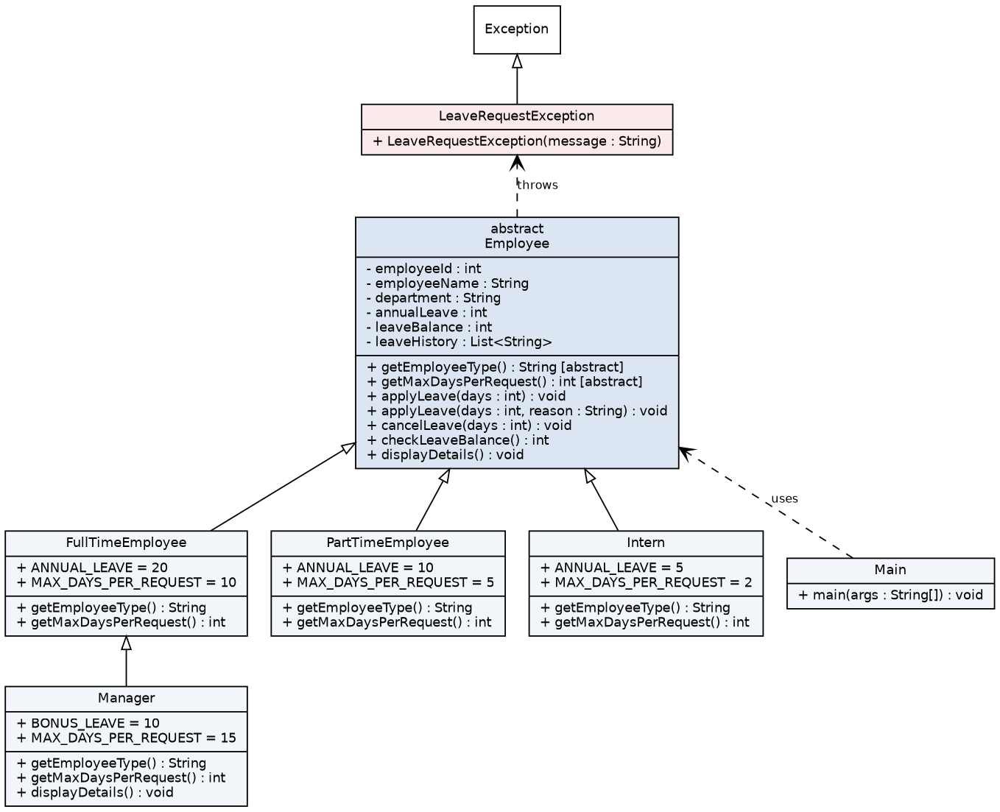

# Leave Management System (Java OOP)

Author: Gurucharan Maripala

A simple console application that stores employee information, manages leave requests and applies
different leave rules based on employee type. It was built first with basic OOP and then refactored.

## Leave rules
| Employee type | Annual leave | Max days per request |
|---------------|--------------|----------------------|
| Full-time     | 20           | 10                   |
| Part-time     | 10           | 5                    |
| Intern        | 5            | 2                    |
| Manager       | 30 (20 + 10 bonus) | 15             |

## Project structure
```
src/leavemgmt/
  Employee.java              abstract base class (shared leave logic)
  FullTimeEmployee.java      extends Employee
  PartTimeEmployee.java      extends Employee
  Intern.java                extends Employee
  Manager.java               extends FullTimeEmployee (change request)
  LeaveRequestException.java custom checked exception
  Main.java                  demo / test driver
docs/
  design.md  class_diagram.png  class_diagram.dot  sample_output.txt  OOP_concepts.md  refactoring_notes.md
```

## How to run
Requires JDK 11 or later.
```
javac -d out src/leavemgmt/*.java
java -cp out leavemgmt.Main
```

## Class diagram


## Documentation
- OOP concepts used: `docs/OOP_concepts.md`
- Refactoring notes: `docs/refactoring_notes.md`
- Sample output: `docs/sample_output.txt`
